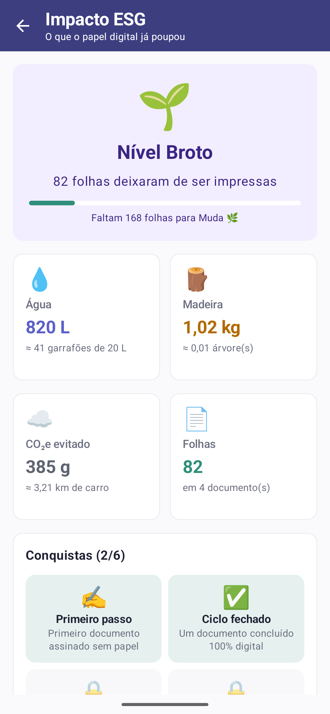
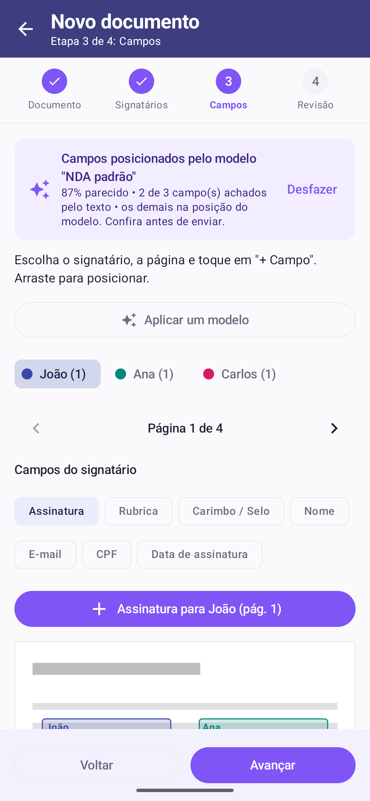
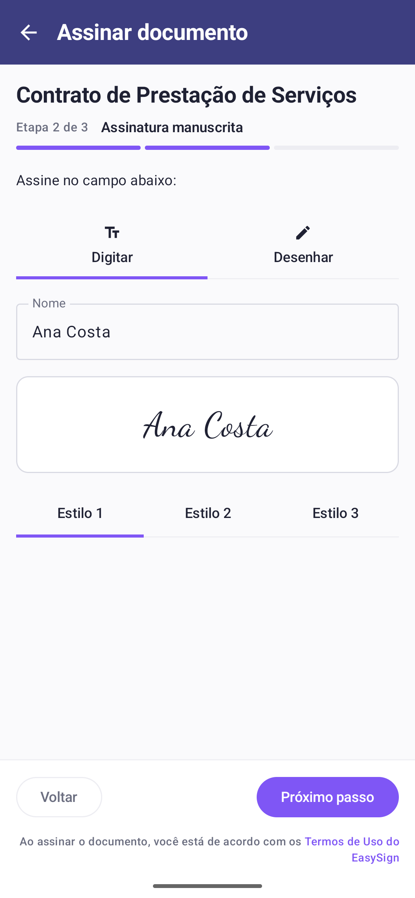
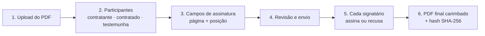
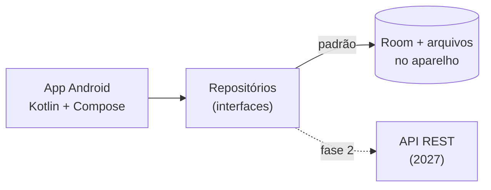

**Plataforma de assinatura eletrônica de documentos PDF**

Envie um contrato, defina quem assina e onde, e acompanhe cada assinatura com trilha de auditoria e hash SHA-256.

-3DDC84?logo=android&logoColor=white)
-lightgrey)

---

  
  
  
  

  
  
  

App Android nativo (Kotlin + Jetpack Compose)

## 🧭 Como funciona

Cada etapa gera um evento na **trilha de auditoria**: quem fez, quando e o hash do documento naquele momento.

## ✨ Destaques

- **Modelos inteligentes:** salve um documento como modelo; ao subir um PDF com o mesmo layout (NDA, proposta padrão), o app reconhece o modelo e posiciona as caixas sozinho, seguindo o texto âncora mesmo que o bloco de assinatura mude de página.
- **Painel de impacto ESG:** litros de água, quilos de madeira e CO₂ poupados ao assinar sem papel, com níveis e conquistas (fatores conservadores e fontes citadas no app).
- **Assinatura em 3 etapas**, como na versão web: revisar, assinar (digitar em 3 estilos ou desenhar) e código de verificação.
- **Campos além da assinatura:** rubrica, carimbo/selo, nome, e-mail, CPF e data, preenchidos no PDF final.
- **Organização:** contatos com CPF, grupos, pastas, categorias, observadores, lembretes e auditoria em abas.
- **Word:** arquivos `.docx` são convertidos em PDF (só o texto) para assinar.
- **Dados de demonstração:** um toque no login cria 17 documentos em todos os estágios e enche o painel ESG (Admin `demo@easysign.com`, senha `demo123`).

## 📦 O que tem neste repositório

| Pasta | O que é | Tecnologia |
|---|---|---|
| [`lets-sign-android`](lets-sign-android) | **App Android nativo**, a entrega do desafio ([documentação](lets-sign-android/docs/DOCUMENTACAO.md) · [melhorias](lets-sign-android/MELHORIAS.md)) | Kotlin, Jetpack Compose, Room, Hilt, PDFBox-Android |

O app funciona **sozinho, sem servidor**: contas, signatários, documentos, assinaturas e PDFs ficam no banco local (Room) e nos arquivos do aparelho. Como os repositórios seguem interfaces, a API REST entra na fase 2 do projeto (2027) sem mudar as telas: o modo `-Pmodo=api` já está no código.

## 🚀 Rodando localmente

### App Android

Abra a pasta **`lets-sign-android`** no Android Studio (não a raiz do repositório) e clique em **▶ Run**. Não precisa de servidor. Passo a passo em [`lets-sign-android/README.md`](lets-sign-android/README.md).

## 🔐 Segurança

- App: senhas guardadas só como hash **PBKDF2 com sal**. Cada usuário só vê os próprios documentos e os que foram enviados para ele.
- Integridade dos documentos por **SHA-256**, registrado no original, em cada versão e no PDF final.

## ✅ Qualidade

- App Android: 42 testes unitários e 9 testes no emulador (fluxo completo sem servidor do cadastro ao PDF final, campos extras, observadores, modelos inteligentes, conversão de `.docx`, migrações do banco e dados de demonstração).
- CI no GitHub Actions (`.github/workflows/android.yml`): testes + APK a cada push no app Android.

## 🗺️ Status

| Módulo | Situação |
|---|---|
| App Android | Todos os fluxos do desafio: perfis Admin e Signatário, cadastro de signatários, assistente com editor de campos, revisão com o documento completo, envio sem duplicar, assinatura, acompanhamento, PDF final gerado no aparelho, banco local (Room) e nova versão que preserva a anterior. Visual da versão web, modelos inteligentes, painel ESG, campos extras, grupos, pastas e observadores |
| API REST | Fase 2 do projeto (2027). O app já tem os repositórios prontos para ela |

## 📄 Licença

Proprietário: LetsSign. Todos os direitos reservados.
