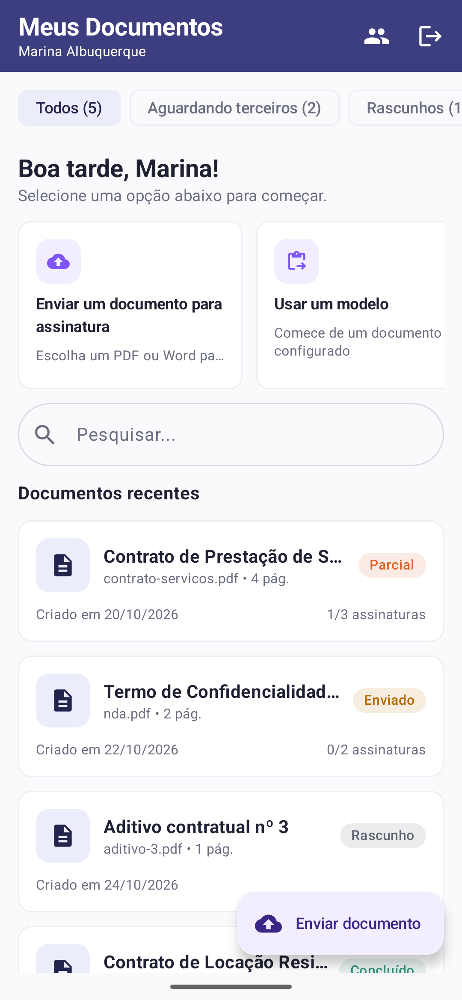
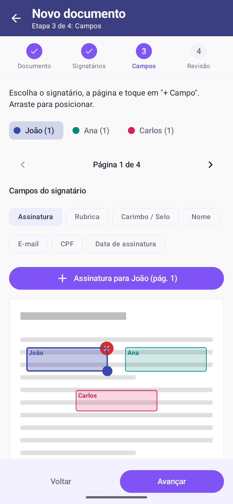
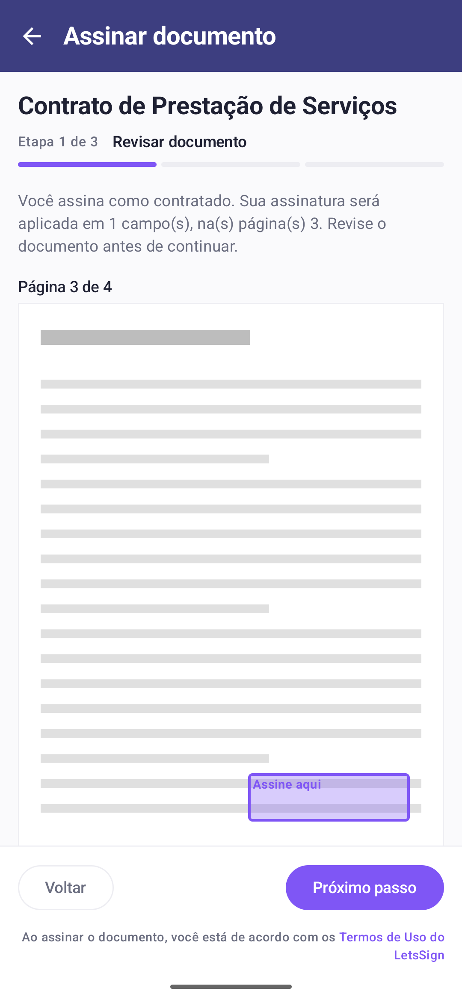
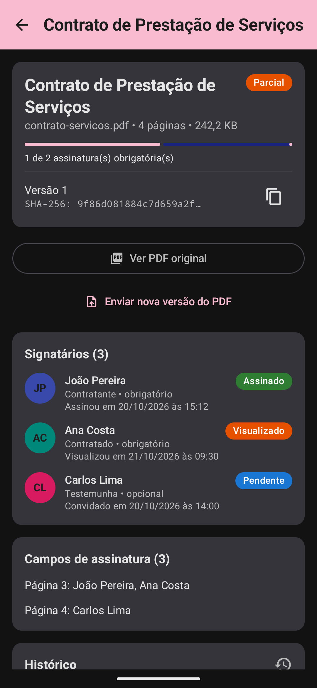
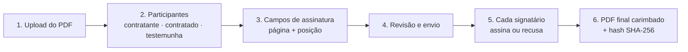
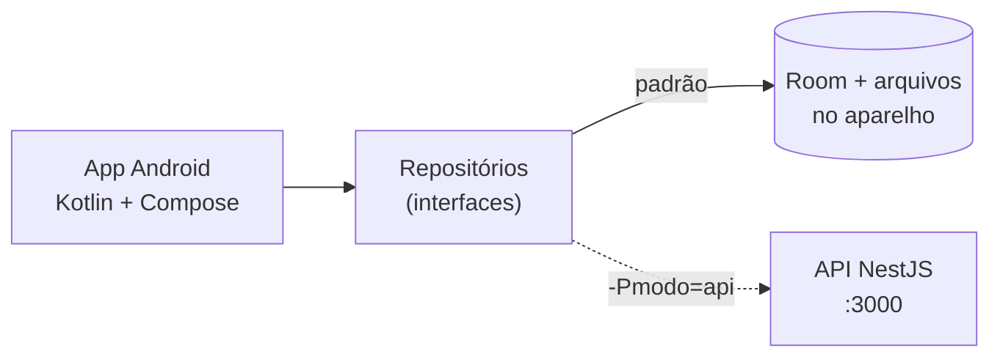

<div align="center">

# ✍️ LetsSign

**Plataforma de assinatura eletrônica de documentos PDF**

Envie um contrato, defina quem assina e onde, e acompanhe cada assinatura com trilha de auditoria e hash SHA-256.


-3DDC84?logo=android&logoColor=white)


</div>

---

<p align="center">
  
  
  
  
</p>
<p align="center"><sub>App Android nativo (Kotlin + Jetpack Compose)</sub></p>

## 🧭 Como funciona



Cada etapa gera um evento na **trilha de auditoria**: quem fez, quando e o hash do documento naquele momento.

## 📦 O que tem neste repositório

| Pasta | O que é | Tecnologia |
|---|---|---|
| [`lets-sign-android`](lets-sign-android) | **App Android nativo**, a entrega do desafio ([documentação](lets-sign-android/docs/DOCUMENTACAO.md) · [melhorias](lets-sign-android/MELHORIAS.md)) | Kotlin, Jetpack Compose, Room, Hilt, PDFBox-Android |
| [`letssign_backend/nodejs_space`](letssign_backend/nodejs_space) | **API REST** (opcional): o app também funciona ligado a ela | NestJS 11, Prisma 6, SQLite |



O app funciona **sozinho, sem servidor**: contas, signatários, documentos, assinaturas e PDFs ficam no banco local (Room) e nos arquivos do aparelho. Como os repositórios seguem interfaces, a mesma base também roda ligada à API REST.

## 🚀 Rodando localmente

### App Android

Abra a pasta **`lets-sign-android`** no Android Studio (não a raiz do repositório) e clique em **▶ Run**. Não precisa de servidor. Passo a passo em [`lets-sign-android/README.md`](lets-sign-android/README.md).

### API (opcional)

Só para usar o app no modo API (`./gradlew assembleDebug -Pmodo=api`):

```bash
cd letssign_backend/nodejs_space
cp .env.example .env          # preencha JWT_SECRET e, se quiser e-mails, o SMTP
npm install
npx prisma generate           # gera o cliente do banco (npm recente não roda esse passo sozinho)
npx prisma migrate dev        # cria o banco SQLite (dev.db)
npx prisma db seed            # opcional: dados de exemplo
npm run start:dev             # http://localhost:3000
```

A documentação interativa da API (Swagger) fica em **http://localhost:3000/api**.

> **Emulador Android:** o app acessa a API em `http://10.0.2.2:3000`, que é o "localhost" do computador visto de dentro do emulador. Num celular físico, use `-PapiUrl=http://IP-DO-COMPUTADOR:3000/`.

## 🔐 Segurança

- App: senhas guardadas só como hash **PBKDF2 com sal**. Cada usuário só vê os próprios documentos e os que foram enviados para ele.
- Integridade dos documentos por **SHA-256**, registrado no original, em cada versão e no PDF final.
- API: senhas com **bcrypt** e autenticação por **JWT**. **Nunca suba o `.env`**: o `.gitignore` da raiz já bloqueia. Use o `.env.example` como modelo.

## ✅ Qualidade

- App Android: 28 testes unitários e 3 testes no emulador (fluxo completo sem servidor, do cadastro ao PDF final assinado, e migração do banco).
- CI no GitHub Actions (`.github/workflows/android.yml`): testes + APK a cada push no app Android.

## 🗺️ Status

| Módulo | Situação |
|---|---|
| App Android | Todos os fluxos do desafio: perfis Admin e Signatário, cadastro de signatários, assistente com editor de campos, revisão com o documento completo, envio sem duplicar, assinatura, acompanhamento, PDF final gerado no aparelho, banco local (Room) e nova versão que preserva a anterior |
| API | Fluxo completo: upload, participantes, campos, envio, assinatura, recusa, nova versão, auditoria, e-mails |

## 📄 Licença

Proprietário: LetsSign. Todos os direitos reservados.
