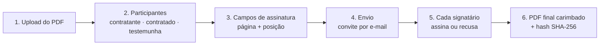
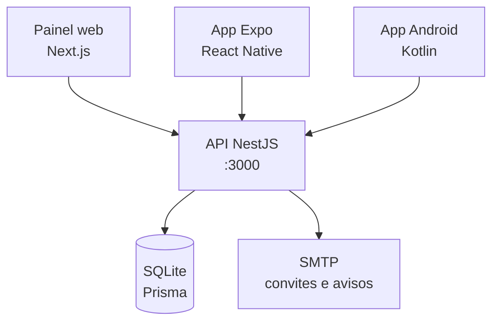

<div align="center">

# ✍️ LetsSign

**Plataforma de assinatura eletrônica de documentos PDF**

Envie um contrato, defina quem assina e onde, e acompanhe cada assinatura com trilha de auditoria e hash SHA-256.


</div>

---

<p align="center">
  
  
  
  
</p>
<p align="center"><sub>App Android nativo (Kotlin + Jetpack Compose)</sub></p>

## 🧭 Como funciona



Cada etapa gera um evento na **trilha de auditoria**: quem fez, quando, IP e o hash do documento naquele momento. Qualquer pessoa pode conferir se um arquivo é autêntico comparando o hash (`GET /documents/{id}/verify`).

## 📦 O que tem neste repositório

| Pasta | O que é | Tecnologia |
|---|---|---|
| [`letssign_backend/nodejs_space`](letssign_backend/nodejs_space) | **API**: documentos, signatários, assinatura, e-mails e auditoria | NestJS 11, Prisma 6, SQLite |
| [`letssign-frontend`](letssign-frontend) | **Painel web** | Next.js 16, React 19 |
| [`letssign-mobile`](letssign-mobile) | **App mobile multiplataforma** | Expo 58, React Native |
| [`lets-sign-android`](lets-sign-android) | **App Android nativo** ([documentação](lets-sign-android/docs/DOCUMENTACAO.md) · [melhorias](lets-sign-android/MELHORIAS.md)) | Kotlin, Jetpack Compose, Hilt |



## 🚀 Rodando localmente

### 1. API (obrigatória para todos os apps)

```bash
cd letssign_backend/nodejs_space
cp .env.example .env          # preencha JWT_SECRET e, se quiser e-mails, o SMTP
npm install
npx prisma generate           # gera o cliente do banco (npm recente não roda esse passo sozinho)
npx prisma migrate dev        # cria o banco SQLite (dev.db)
npx prisma db seed            # opcional: dados de exemplo
npm run start:dev             # http://localhost:3000
```

A documentação interativa da API (Swagger) fica em **http://localhost:3000/api**.

### 2. Painel web

A API já usa a porta 3000, então o painel sobe na **3001**:

```bash
cd letssign-frontend
npm install
NEXT_PUBLIC_API_URL=http://localhost:3000 npx next dev -p 3001
```

Abra http://localhost:3001.

### 3. App mobile (Expo)

```bash
cd letssign-mobile
npm install
npx expo start                # tecle "a" para abrir no emulador Android
```

### 4. App Android nativo

Abra a pasta **`lets-sign-android`** no Android Studio (não a raiz do repositório) e clique em **▶ Run**. Passo a passo em [`lets-sign-android/README.md`](lets-sign-android/README.md).

> **Emulador Android:** os apps acessam a API em `http://10.0.2.2:3000`, que é o "localhost" do computador visto de dentro do emulador. Num celular físico, use o IP do computador na rede.

## 🔐 Segurança

- **Nunca suba o `.env`**: o `.gitignore` da raiz já bloqueia. Use o `.env.example` como modelo.
- Senhas guardadas com **bcrypt**; autenticação por **JWT** (validade de 7 dias).
- Integridade dos documentos por **SHA-256**, guardado em cada versão e no PDF final.

## ✅ Qualidade

- App Android: 28 testes unitários e teste ponta a ponta no emulador contra a API real (passo a passo no [MELHORIAS.md](lets-sign-android/MELHORIAS.md)).
- CI no GitHub Actions (`.github/workflows/android.yml`): testes + APK a cada push no app Android.

## 🗺️ Status

| Módulo | Situação |
|---|---|
| API | Fluxo completo: upload, participantes, campos, envio, assinatura, recusa, nova versão, auditoria, e-mails |
| Painel web | Login, dashboard, documentos (lista, novo, detalhe, edição), signatários e relatórios |
| App Expo | Login, documentos, pendentes e assinados |
| App Android | Todos os fluxos do desafio: perfis, signatários, assistente com editor de campos, envio sem duplicar, assinatura, acompanhamento, banco local (Room) e nova versão de documento. **41 de 41 itens** ([MELHORIAS.md](lets-sign-android/MELHORIAS.md)) |

## 📄 Licença

Proprietário: LetsSign. Todos os direitos reservados.
