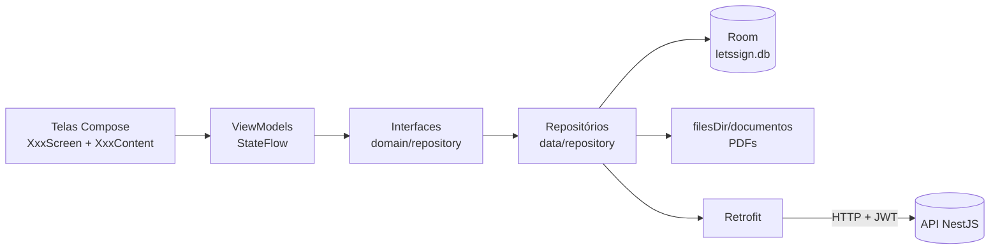
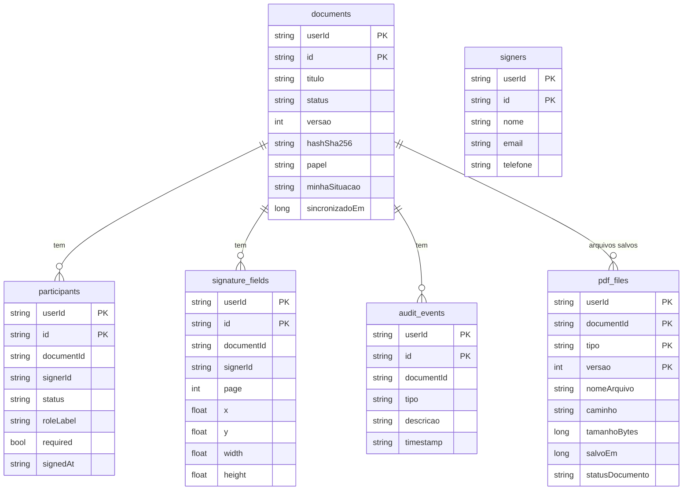
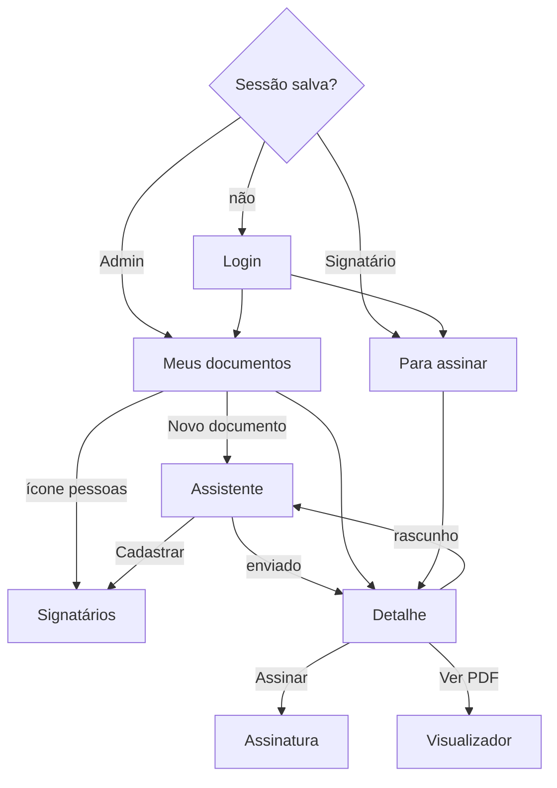

# Documentação técnica — LetsSign Android

App nativo Android (Kotlin + Jetpack Compose) do desafio **FIAP × LetsSign, Sprint 1**: preparar documentos PDF, escolher signatários, posicionar campos de assinatura, enviar, assinar e acompanhar o processo pelo celular.

## Sumário

1. [Arquitetura](#arquitetura)
2. [Persistência local (Room + arquivos)](#persistência-local)
3. [Telas e navegação](#telas-e-navegação)
4. [Fluxos principais](#fluxos-principais)
5. [Regras de negócio](#regras-de-negócio)
6. [API usada](#api-usada)
7. [Previews e screenshots](#previews-e-screenshots)
8. [Testes e CI](#testes-e-ci)
9. [Build e versões](#build-e-versões)

---

## Arquitetura

MVVM em camadas, com injeção de dependência pelo Hilt e dados **offline-first**: as telas leem sempre do banco local, e a API REST sincroniza esse banco.



- **Telas** (`presentation/ui/screens`): cada uma tem `XxxScreen`, que pega o ViewModel e navega, e `XxxContent`, que só desenha a partir de parâmetros. É o `Content` que os `@Preview` usam.
- **ViewModels** (`presentation/viewmodel`): expõem um `StateFlow<UiState>` que combina o banco local (Flow do Room) com o estado da tela.
- **Interfaces de repositório** (`domain/repository/Repositories.kt`): é tudo o que os ViewModels conhecem. Trocar a fonte de dados (só local, só REST ou as duas) não mexe nas telas. Esse é o requisito "estruturar repositórios para possibilitar futuramente a persistência por APIs REST".
- **Regras de negócio** (`domain/rules/DocumentRules.kt`): funções puras com as validações do desafio, cobertas por testes.

### Estrutura de pastas

```
app/src/main/java/com/letsign/mobile/
├── data/
│   ├── api/            ApiClient (Retrofit/OkHttp, token, 401) e ApiServices (endpoints + DTOs)
│   ├── local/          TokenManager (sessão)
│   │   └── db/         AppDatabase, Entities, Daos, Mappers (Room)
│   ├── pdf/            PdfStorage (arquivos), PdfDocumentRenderer (PdfRenderer nativo), PdfImporter
│   └── repository/     AuthRepositoryImpl, DocumentRepositoryImpl, SignerRepositoryImpl, apiCall()
├── di/                 RepositoryModule (Hilt)
├── domain/
│   ├── model/          User, Document, Participant, SignatureField, AuditEvent, LocalPdf, SendDraft...
│   ├── repository/     interfaces
│   └── rules/          DocumentRules (validações + geometria dos campos)
└── presentation/
    ├── navigation/     AppNavHost (rotas e tela inicial por perfil)
    ├── theme/          cores claro/escuro, tipografia
    ├── ui/components/  componentes, PdfPageView/FieldBox, SignaturePad
    ├── ui/screens/     auth, documents, wizard, signers, sign, pdf
    ├── ui/preview/     PreviewData + @ScreenPreviews
    ├── util/           datas, tamanhos
    └── viewmodel/
app/schemas/            esquema do banco exportado pelo Room (base para migrações)
```

## Persistência local

Requisito do desafio: *"Registros em geral → banco de dados local (Room)"* e *"PDF salvo no sistema de arquivos com o registro no banco (nome, caminho, data, status)"*.

### Tabelas (Room, `letssign.db`, versão 1)



- **Isolamento entre usuários:** toda tabela tem `userId` (o usuário logado) na chave primária e toda consulta filtra por ele. Além disso, **login, logout e sessão expirada apagam o banco e os PDFs** (`LocalDataCleaner`). Regra: *"dados de um usuário não podem ser acessados por outro"*.
- **PDFs:** ficam em `filesDir/documentos/<usuário>/<documento>-<tipo>-v<versão>.pdf`, privados do app. A tabela `pdf_files` registra nome, caminho, tamanho, data e status. O download é gravado num `.tmp` e renomeado, então um download interrompido nunca deixa PDF pela metade.
- **Por que não BLOB:** o `CursorWindow` do Android lê no máximo ~2 MB por linha, e o backend aceita PDFs de até 15 MB.
- **Sincronização:** `refreshDocuments()` usa a lista da API como fonte da verdade sobre *quais* documentos existem (remove os que sumiram). `refreshDocument(id)` substitui participantes, campos e eventos do documento. Sem internet, as telas continuam mostrando o que está salvo, com um aviso.

## Telas e navegação

| Rota | Tela | Quem | Arquivo |
|---|---|---|---|
| `login` / `register` | Login e cadastro (o cadastro cria conta **Admin**) | todos | `screens/auth/AuthScreens.kt` |
| `documents` | Início do Admin: lista com filtros (Todos, Rascunhos, Enviados, Parciais, Concluídos, Cancelados) | Admin | `screens/documents/DocumentListScreens.kt` |
| `inbox` | Início do Signatário: abas Pendentes, Assinados e Cancelados | Signatário | `screens/documents/DocumentListScreens.kt` |
| `document/{id}` | Acompanhamento: status, progresso, signatários com data e hora, campos, histórico, arquivos salvos; ações de assinar/recusar, ver PDF e **enviar nova versão** | todos | `screens/documents/DocumentDetailScreen.kt` |
| `new_document` | Assistente: Documento → Signatários → Campos → Revisão | Admin | `screens/wizard/NewDocumentScreen.kt` |
| `edit_document/{id}` | O mesmo assistente para continuar um rascunho | Admin | idem |
| `signers` | Cadastro de signatários (listar, buscar, criar, editar, remover) | Admin | `screens/signers/SignersScreen.kt` |
| `sign/{id}` | Assinatura: páginas com os campos do signatário + área de assinatura | Signatário | `screens/sign/SignDocumentScreen.kt` |
| `pdf/{id}/{original\|final}` | Visualizador de PDF + compartilhar / abrir com outro app | todos | `screens/pdf/PdfViewerScreen.kt` |



Logout, ou um **401** da API (token expirado), limpa os dados locais e volta para o login com o aviso "Sua sessão expirou".

## Fluxos principais

### Admin: enviar um PDF para assinatura

1. **Documento:** seleciona o PDF pelo seletor nativo (`OpenDocument`, sem permissão de armazenamento). O app copia o arquivo, verifica o tamanho (≤ 15 MB) e abre com o `PdfRenderer`. Se o arquivo não for PDF, estiver corrompido, protegido por senha ou sem páginas, aparece uma mensagem clara. O título é sugerido pelo nome do arquivo.
2. **Signatários:** escolhe entre os cadastrados, classifica cada um (contratante, contratado, testemunha), marca quem é obrigatório, remove ou **substitui** (o substituto herda papel e campos). O botão "Cadastrar" leva ao cadastro sem perder o que foi preenchido.
3. **Campos:** para cada signatário (cor própria), escolhe a página e toca "+ Campo". O campo pode ser **arrastado**, **redimensionado** pela bolinha do canto e **excluído** pelo ✕. É possível pôr vários campos para a mesma pessoa. A posição e o tamanho são guardados **em fração da página (0..1)**, então o campo fica no mesmo lugar em qualquer tela ou aparelho, e o app não deixa o campo sair da página.
4. **Revisão:** mostra o documento, os signatários com papel e número de campos, miniaturas das páginas com os campos, e o campo da mensagem do convite (≤ 2000 caracteres).
5. **Envio:** o app cria o documento (só na primeira tentativa) e envia participantes, campos e mensagem numa única chamada. **Se falhar, os dados ficam na tela e "Tentar novamente" reaproveita o mesmo documento.** Somado à idempotência do backend (`jaEnviado`), isso garante que nenhuma solicitação é duplicada (coberto por teste).

### Signatário: assinar e salvar

1. A aba **Pendentes** lista o que falta assinar. O backend marca o documento como "visualizado" quando o detalhe é aberto.
2. **Assinar** abre as páginas onde estão os campos dele, destacados, e a área de assinatura com o dedo.
3. Ao confirmar, o app envia o PNG da assinatura e os metadados do gesto (traços, pontos, duração, aparelho). Depois atualiza o registro local com o novo status e, se o documento ficou concluído, já **salva o PDF final assinado no aparelho**.
4. **Recusar** pede o motivo. Se o signatário for obrigatório, o backend cancela o documento.

### Admin: nova versão de um documento já enviado

Regra do desafio: *"o documento enviado e suas configurações devem ser preservados; alterações posteriores deverão gerar uma nova versão e um novo fluxo"*.

1. No detalhe de um documento enviado, parcial ou cancelado (nunca concluído), o dono toca em **"Enviar nova versão do PDF"**.
2. A confirmação explica o que vai acontecer: a versão atual fica preservada, o documento volta a rascunho e as assinaturas já feitas são descartadas (informa quantas).
3. O app valida o novo PDF (mesmas regras do assistente) e envia para `POST /documents/{id}/version`.
4. O assistente abre como **"Nova versão (vN)"**, com signatários e campos mantidos sobre o PDF novo (campos de páginas que deixaram de existir são removidos pelo backend). O Admin revisa e reenvia pelo mesmo fluxo idempotente.
5. O histórico registra "Versão N criada (versão anterior preservada)". No aparelho, os PDFs de cada versão ficam registrados separadamente em `pdf_files`.

### Acompanhamento

O detalhe mostra a situação geral, o progresso ("2 de 3 assinaturas obrigatórias") e cada signatário com data e hora de convite, visualização, assinatura ou recusa (no fuso do aparelho). Mostra também o **histórico** completo (criação, envio, visualizações, assinaturas, conclusão), o hash SHA-256 (copiável, para verificação) e o PDF final quando concluído.

## Regras de negócio

| Regra | Onde no app | Onde no backend |
|---|---|---|
| Pelo menos 1 signatário (e 1 obrigatório) | `DocumentRules.validateParticipants` | `documents.service.ts` (send) |
| Todo campo associado a um participante | `validateFields`; remover um signatário remove os campos dele | send |
| Campos dentro dos limites da página | `moveBy`/`resizeBy` limitam o arraste; `validateFields` | `validateFields` |
| Dados obrigatórios validados antes do envio | validação por etapa no assistente | DTOs + send |
| Documento enviado preservado; alteração gera nova versão | documento enviado não abre no assistente; `Document.canCreateNewVersion` + fluxo "Enviar nova versão" | snapshot no envio + `/version` |
| Concluído só quando todos os obrigatórios assinam | exibe o status do servidor | sign |
| Dados de um usuário inacessíveis a outro | `userId` em todas as tabelas + limpeza no login/logout | `access()` |

## API usada

URL base: `BuildConfig.API_BASE_URL` em `app/build.gradle.kts`. O padrão é `http://10.0.2.2:3000/` (o localhost do computador visto de dentro do emulador).

| Método | Rota | Uso |
|---|---|---|
| POST | `auth/login`, `auth/register` | sessão (token JWT + usuário com `role`) |
| GET | `documents` | lista (Admin: os que criou; Signatário: os recebidos, com `minhaSituacao`) |
| GET | `documents/{id}` | detalhe com `signers`, `fields` e `events` (auditoria) |
| POST | `documents` (multipart `pdf` + `titulo`) | cria o rascunho |
| POST | `documents/{id}/send` | participantes + campos + mensagem, idempotente |
| POST | `documents/{id}/version` (multipart `pdf`) | nova versão: preserva a anterior, zera assinaturas, volta a rascunho |
| POST | `documents/{id}/sign`, `/reject` | assinar, recusar |
| GET | `documents/{id}/file?tipo=original\|final` | baixar PDF |
| GET/POST/PATCH/DELETE | `signers[/{id}]` | cadastro de signatários |

Erros do backend (`{ "mensagem": "..." }`) viram o texto mostrado na tela (`apiCall()` em `data/repository/ApiCall.kt`). Swagger: `http://localhost:3000/api`.

## Previews e screenshots

Abra qualquer arquivo de tela no Android Studio e use o modo **Split** ou **Design**. As telas principais aparecem em tema claro e escuro (`@ScreenPreviews`), com os dados fictícios de `ui/preview/PreviewData.kt`.

| Arquivo | Previews |
|---|---|
| `auth/AuthScreens.kt` | login, login com erro, cadastro |
| `documents/DocumentListScreens.kt` | início do Admin (cheio, vazio, offline), início do Signatário (pendentes, assinados) |
| `documents/DocumentDetailScreen.kt` | detalhe visto pelo Admin e pelo Signatário |
| `wizard/NewDocumentScreen.kt` | cada etapa, PDF inválido, falha no envio, sucesso, nova versão |
| `signers/SignersScreen.kt` | lista, formulário com erro |
| `sign/SignDocumentScreen.kt` | assinatura, concluída |
| `pdf/PdfViewerScreen.kt` | visualizador |
| `components/SignaturePad.kt` | área de assinatura vazia e preenchida |

Para regerar as imagens de `docs/screenshots`, abra um emulador e rode `bash docs/screenshots/capturar.sh`. O backend não precisa estar rodando.

## Testes e CI

```bash
./gradlew testDebugUnitTest
```

| Arquivo | O que cobre |
|---|---|
| `DocumentRulesTest` | todas as regras de negócio, arraste e redimensionamento dentro da página, validação de signatário, quem pode criar nova versão |
| `ParsingTest` | erros da API, 401, falta de rede, datas no fuso do aparelho, JSON com campos e enums desconhecidos, ida e volta pelo banco |
| `ViewModelTest` | assistente (validação por etapa, montagem do envio, **nova tentativa sem duplicar**, remover e substituir signatário, rascunho existente), nova versão (sucesso, PDF inválido sem chamar a API, recusa do servidor) e sessão expirada |

### Teste ponta a ponta (manual, no emulador)

Feito com o backend real (cópia isolada, banco de teste, SMTP desligado). O fluxo completo, do Admin enviando até os signatários assinarem, está descrito no [MELHORIAS.md](../MELHORIAS.md#teste-ponta-a-ponta-realizado-emulador-android-17--backend-real). Ele incluiu a API desligada no meio do envio, a recusa e a sessão expirada. Imagens em `docs/screenshots/fluxo-real/`.

### CI

O CI fica em `.github/workflows/android.yml`, na raiz do repositório. A cada push ou PR em `lets-sign-android/` ele roda os testes e gera o APK debug, que fica disponível como artefato.

## Build e versões

| Item | Versão |
|---|---|
| Gradle (wrapper) / Android Gradle Plugin | 9.8.2 / 9.4.0 |
| Kotlin / Compose BOM | 2.3.21 / 2026.09.00 (Material 3 1.4) |
| Room / Hilt / KSP | 2.8.5 / 2.60.1 / 2.3.12 |
| Retrofit / kotlinx-serialization | 3.0.0 / 1.10.0 |
| compileSdk / targetSdk / minSdk | 37 / 36 / 24 |

```bash
./gradlew assembleDebug      # app/build/outputs/apk/debug/app-debug.apk
./gradlew installDebug       # instala no emulador/celular conectado
./gradlew assembleRelease    # com R8; assina se KEYSTORE_PATH/KEYSTORE_PASSWORD/KEY_ALIAS/KEY_PASSWORD estiverem definidos
```
