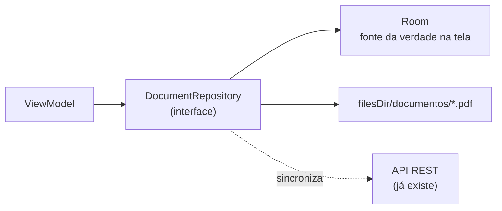

# Melhorias — EasySign Android

Análise do app Kotlin em `lets-sign-android/` feita em 25/10/2026.

**Legenda:** ✅ corrigido nesta revisão · ⏳ pendente (próximos passos)

**Resumo:** o código original **não compilava**: eram dezenas de erros de compilação e de configuração do Gradle (lista em §2). Esta revisão corrigiu o necessário para o app compilar, abrir no Android Studio e mostrar os previews, além dos bugs que deixavam as telas existentes inúteis (login que não saía da tela, token que nunca era salvo, lista que nunca carregava). As **features que faltam continuam faltando** e estão listadas em [§5](#5-funcionalidades-faltando-o-readme-antigo-prometia).

Backup do código original: `C:\Users\MKosky\code\lets-sign-android-backup-2026-10-25`.

---

## 0. Aderência aos requ\zisitos do desafio (FIAP × LetsSign, Sprint 1)

Fonte: slides em `C:\Users\MKosky\Desktop\challenge` (1.png a 9.png).

**Legenda desta seção:** ✅ atende · 🟡 parcial · ❌ não atende

**Resumo:** o **backend já cumpre praticamente todas as regras de negócio** do desafio: mínimo de 1 signatário, campos dentro da página, PDF corrompido, envio sem duplicar, versões, conclusão só com todos os obrigatórios assinando, isolamento de dados. A distância está no **app Android**. Hoje ele atende por completo 6 de 41 itens: 4 regras de negócio, ser nativo e mostrar a situação geral do documento. Das funcionalidades obrigatórias, só essa última está completa. E o app **não tem banco local**, que é um requisito técnico explícito.

### Placar

| Área | ✅ | 🟡 | ❌ |
|---|---|---|---|
| 1. Acesso e tela inicial | 0 | 3 | 3 |
| 2. Cadastro de signatários | 0 | 1 | 1 |
| 3. Fluxo de cadastro de documento | 0 | 0 | 8 |
| 4. Posicionamento das assinaturas | 0 | 1 | 4 |
| 5. Revisão e disparo | 0 | 1 | 2 |
| 6. Acompanhamento | 1 | 1 | 3 |
| Requisitos técnicos | 1 | 2 | 2 |
| Regras de negócio (no app) | 4 | 3 | 0 |
| **Total (41 itens)** | **6** | **12** | **23** |

### 1. Acesso e tela inicial

| | Requisito | Situação hoje | O que falta |
|---|---|---|---|
| 🟡 | Login para 2 perfis: Admin e Signatário | O login funciona para os dois (o backend devolve `role`), mas os dois caem na mesma tela | Tela inicial por perfil: Admin vê "Meus documentos" + "Signatários"; Signatário vê "Pendentes" e "Assinados" |
| ❌ | Admin: iniciar documento por upload de PDF | Rota `new_document` abre "Em construção" | Ver §3 abaixo |
| 🟡 | Admin: ver enviados, parcialmente assinados e concluídos | A lista mostra todos com chip de status e progresso "1/3 assinaturas" | Abas ou filtro por status (o endpoint já aceita `?status=`) |
| ❌ | Admin: cadastrar signatários | Sem tela (`SignerViewModel` pronto) | Ver §2 abaixo |
| 🟡 | Signatário: ver pendentes e já assinados | `GET /documents` já devolve os documentos do signatário com `minhaSituacao`, mas a tela não separa | Duas abas usando `?situacao=PENDING` e `?situacao=SIGNED` |
| ❌ | Signatário: assinar o documento | `SignaturePad` pronto e envio pronto no repositório; sem botão nem tela | Botão "Assinar" no detalhe → tela com o PDF + `SignaturePad` → `signDocument()` |

### 2. Cadastro de signatários

| | Requisito | Situação hoje | O que falta |
|---|---|---|---|
| ❌ | Admin cadastra e edita signatários | Sem tela | Lista + formulário (criar/editar/excluir) |
| 🟡 | Campos mínimos: nome, e-mail, telefone, senha | A API aceita os 4, mas o backend trata **telefone como opcional** | Validar no formulário: os 4 obrigatórios, e-mail válido, senha ≥ 6 |

### 3. Fluxo de cadastro de documento (envio de PDF existente)

| | Requisito | Situação hoje | O que falta |
|---|---|---|---|
| ❌ | 1. Cadastrar um novo fluxo | — | Assistente em etapas (`HorizontalPager` ou rotas aninhadas) |
| ❌ | 2. Informar o título | — | Campo com validação (obrigatório, ≤ 200 caracteres, igual ao backend) |
| ❌ | 3. Selecionar PDF no celular | — | `ActivityResultContracts.OpenDocument("application/pdf")`, nativo e sem permissão de armazenamento |
| ❌ | 4. Selecionar e classificar signatários (contratante, contratado, testemunha) | Enum `RoleLabel` existe | Lista com busca, papel e "obrigatório" por signatário |
| ❌ | 5. Visualizar as páginas do PDF | — | `android.graphics.pdf.PdfRenderer` (nativo) renderizando cada página em `Bitmap` |
| ❌ | 6. Posicionar os campos | — | Ver §4 |
| ❌ | 7. Revisar e confirmar | — | Ver §5 |
| ❌ | Avisar arquivo inválido, corrompido ou impossível de processar | O backend já responde "O PDF está corrompido..." / "protegido por senha" e o app já mostra a `mensagem` | Validar **antes** do upload: abrir com `PdfRenderer` em `try/catch` e checar tamanho ≤ 15 MB (limite do backend) |

Regras do mesmo slide: mínimo 1 signatário obrigatório, validar os dados, remover ou substituir assinantes antes do envio. O backend recusa o envio sem signatário, mas a tela precisa impedir antes, com mensagem clara.

### 4. Posicionamento das assinaturas

| | Requisito | Situação hoje | O que falta |
|---|---|---|---|
| ❌ | Adicionar campo de assinatura para o signatário | — | Botão "+ campo" escolhendo o signatário (cor diferente por pessoa) |
| ❌ | Escolher a página e arrastar o campo | — | Retângulo sobre o `Bitmap` da página com `detectDragGestures` (mesma técnica do `SignaturePad`) |
| ❌ | Mover ou excluir antes do envio | — | Arrastar para mover; toque longo ou ícone ✕ para excluir |
| ❌ | Mais de um campo para o mesmo signatário | — | Nada impede no modelo; é só a UI permitir |
| 🟡 | **Técnico:** salvar página, posição e dimensões relativas à página | `FieldRequest` e o backend já usam coordenadas normalizadas 0..1 | Converter pixels da tela ↔ 0..1 dividindo pelo tamanho do `Bitmap` renderizado; manter o campo dentro da página (`coerceIn`) |

### 5. Revisão e disparo

| | Requisito | Situação hoje | O que falta |
|---|---|---|---|
| ❌ | Mostrar documento final, signatários, campos e páginas | — | Tela de revisão com miniaturas das páginas que têm campos |
| 🟡 | Mensagem que acompanha o convite | `SendRequest.mensagem` existe, mas o app envia vazio | Campo de texto (≤ 2000 caracteres, igual ao backend) |
| ❌ | Registrar o envio, mostrar o resultado, permitir nova tentativa **sem duplicar** | O backend é idempotente (responde `jaEnviado: true`), mas `sendDocument()` descarta `jaEnviado` e `mensagem` | Devolver o `SendResponse` inteiro, mostrar a mensagem do servidor e manter o botão "Tentar novamente" em caso de falha de rede |

### 6. Acompanhamento

| | Requisito | Situação hoje | O que falta |
|---|---|---|---|
| ✅ | Situação geral do documento | Chip de status no detalhe e na lista | — |
| 🟡 | Situação individual dos signatários | Mostra o status de cada um | Mostrar também a data/hora em que assinou ou recusou (`signedAt`/`rejectedAt` já vêm da API) |
| ❌ | Datas e horários dos principais eventos | Só a data de criação na lista (dia, sem hora) | Formatar data **e hora** no fuso do aparelho |
| ❌ | Histórico de criação, envio e assinatura | `getAudit()` mapeado, sem tela | Linha do tempo com `GET /documents/{id}/audit` |
| ❌ | Documento final quando concluído | O botão de download não faz nada | Baixar `?tipo=final`, salvar e abrir (ver persistência abaixo) |

### Requisitos técnicos

| | Requisito | Situação hoje | O que falta |
|---|---|---|---|
| ✅ | App **nativo** Android ou iOS | Kotlin + Jetpack Compose | — |
| ❌ | Contemplar **todas** as funcionalidades principais | Ver as tabelas acima | — |
| ❌ | **Persistência local** (Room / SQLite) para os registros | **Não existe.** Tudo vem da API REST e só o token fica no aparelho. O Room estava declarado no projeto original, mas nunca foi usado (e foi removido na limpeza) | Adicionar **Room** com `UserEntity`, `DocumentEntity`, `ParticipantEntity`, `FieldEntity`, `AuditEventEntity`. Ver a abordagem recomendada abaixo |
| 🟡 | Repositórios estruturados para trocar por API REST no futuro | As interfaces `DocumentRepository`, `SignerRepository` e outras já existem e o ViewModel só conhece a interface | Criar a implementação local (Room) atrás das mesmas interfaces |
| 🟡 | PDF salvo no **sistema de arquivos** + registro no banco, **ou** como **BLOB** | Hoje o PDF só existe no servidor | **Recomendado: sistema de arquivos** (`filesDir/documentos/<id>-v<versao>.pdf`) + `DocumentEntity` com nome, caminho, data, status e hash. BLOB não serve aqui: o `CursorWindow` do Android lê no máximo ~2 MB por linha, e o backend aceita PDFs de até 15 MB |

**Manipulação de PDF** (sugestão do slide: Canvas + PDFBox-Android):
- **Visualizar:** `PdfRenderer`, nativo do Android, sem biblioteca.
- **Carimbar a assinatura no PDF localmente** (se o app precisar funcionar offline): `com.tom-roush:pdfbox-android`. Com a API online, o backend já carimba e gera o hash final (`pdf.util.ts`).

### Regras de negócio

O backend valida todas. No app, falta validar **antes** de chamar a API, para orientar o usuário sem depender do servidor.

| | Regra | Backend | App |
|---|---|---|---|
| 🟡 | Pelo menos 1 signatário para enviar | ✅ `documents.service.ts:235` | ❌ falta validar na tela |
| 🟡 | Cada campo associado a um participante | ✅ `:239` | ❌ falta validar na tela |
| 🟡 | Campos dentro dos limites da página | ✅ `:161` e `:243` | ❌ o editor de campos precisa limitar o arraste |
| ✅ | Dados obrigatórios validados antes do envio | ✅ | ✅ o app mostra a mensagem do servidor (validar também na tela) |
| ✅ | Documento enviado preservado; alteração gera nova versão e novo fluxo | ✅ snapshot da configuração no envio (`:254`) + `POST /documents/{id}/version` | ✅ `newVersion()` no repositório (sem tela ainda) |
| ✅ | Concluído só quando **todos os obrigatórios** assinam | ✅ `:347` | ✅ o app só exibe o status |
| ✅ | Dados de um usuário inacessíveis a outro sem envio | ✅ `access()` em `:43` (dono ou participante) | ✅ hoje; ⚠️ com Room, filtrar por usuário logado e **apagar o banco local no logout** |

### Abordagem recomendada para a persistência

Para cumprir o requisito de banco local **sem jogar fora** a API que já funciona:

1. As telas leem do **Room** (`Flow`). A lista funciona offline e abre na hora.
2. O repositório busca da API e grava no Room (*offline-first*).
3. PDFs baixados ou importados ficam em `filesDir`, e o caminho fica registrado em `DocumentEntity`.
4. As interfaces atuais não mudam. Trocar a fonte (só local, só REST ou as duas) não mexe nos ViewModels.

### Roteiro sugerido para atender o desafio

| # | Entrega | Itens que cobre | Esforço estimado |
|---|---|---|---|
| 1 | Room + PDFs em `filesDir` + repositórios offline-first | Persistência, isolamento por usuário | 2 dias |
| 2 | Tela inicial por perfil + logout + tratar 401 | Acesso (1) | 0,5 dia |
| 3 | CRUD de signatários | Cadastro (2) | 1 dia |
| 4 | Assistente: título → PDF → signatários → páginas (`PdfRenderer`) | Fluxo (3) | 2 dias |
| 5 | Editor de campos sobre a página (arrastar, mover, excluir, vários por pessoa) | Posicionamento (4) | 2 dias |
| 6 | Revisão + mensagem + envio idempotente | Revisão e disparo (5) | 1 dia |
| 7 | Signatário: abas Pendentes/Assinados + tela de assinatura | Acesso (1), assinatura | 1 dia |
| 8 | Linha do tempo (auditoria) + data/hora + baixar e abrir o PDF final | Acompanhamento (6) | 1 dia |
| 9 | Testes de ViewModel e das validações + CI | Qualidade | 1 dia |
| | **Total** | | **~11,5 dias de 1 dev** |

---

## Outras melhorias técnicas (fora do escopo direto do desafio)

| # | O quê | Esforço estimado |
|---|-------|------------------|
| 1 | Token criptografado (Android Keystore) | 0,5 dia |
| 2 | CI no GitHub Actions rodando build + testes | 1–2 horas |

---

## 1. Build e configuração

| Status | Problema encontrado | O que foi feito / sugestão |
|---|---|---|
| ✅ | Faltava `gradle-wrapper.jar`; Gradle 8.5 não roda no JDK 25 do Android Studio atual | Wrapper regenerado com **Gradle 9.8.2** |
| ✅ | AGP 8.5 + Kotlin 1.9 + KSP de outra versão (1.9.20 ≠ 1.9.24) | **AGP 9.4.0**, **Kotlin 2.3.21** (Compose Compiler plugin), KSP 2.3.12, Hilt 2.60.1 |
| ✅ | `compileSdk 34`, mas a máquina só tem o SDK 37 instalado; Google Play exige target recente | `compileSdk 37`, `targetSdk 36` |
| ✅ | `signingConfig` usado antes de ser declarado → o Gradle falhava ao configurar | Bloco reordenado; release só assina se `KEYSTORE_PATH` existir |
| ✅ | `proguard-rules.pro` referenciado mas inexistente | Arquivo criado |
| ✅ | `package=` no Manifest (proibido no AGP 8+) | Removido (fica só o `namespace`) |
| ✅ | Ícone `@mipmap/ic_launcher` inexistente → falha no AAPT | Ícone vetorial provisório em `res/drawable/ic_launcher.xml` |
| ✅ | ~15 dependências sem uso (Room, RxJava3, LiveData, Fragment, Coil, PDF viewer do JitPack, Play Services, Mockito, DataBinding/ViewBinding) e `hilt-lifecycle-viewmodel:1.2.0` (artefato que não existe) | Removidas. APK e build ficam menores e mais rápidos |
| ✅ | Código usava **Gson**, mas a dependência declarada era kotlinx-serialization | Padronizado em **kotlinx-serialization** |
| ✅ | `BuildConfig.DEBUG` usado com `buildConfig` desligado; URL da API fixa no código | `buildConfig = true` e `BuildConfig.API_BASE_URL` |
| ✅ | Sem `.gitignore` (risco de subir `local.properties`, `build/` e keystore) | `.gitignore` criado |
| ⏳ | Versões espalhadas no `build.gradle.kts` | Migrar para *version catalog* (`gradle/libs.versions.toml`) |
| ⏳ | Plugin de screenshot test (`com.android.compose.screenshot` alpha16) quebra com AGP 9.4/Gradle 9.8 | Reavaliar numa versão nova do plugin; por enquanto as imagens saem de `docs/screenshots/capturar.sh` |
| ⏳ | Sem CI | GitHub Actions: `./gradlew assembleDebug testDebugUnitTest` a cada push/PR |

## 2. Erros de compilação no Kotlin (todos ✅)

- `import` no **fim** de arquivos (`RepositoryImpl.kt`, `Theme.kt`, `DocumentScreens.kt`), o que é inválido em Kotlin.
- Tipo `ApiServices` usado no DI e nos repositórios, mas ele **não existe** (as interfaces são `AuthApi`, `DocumentsApi` e `SignersApi`). Os três `@Provides` retornavam o mesmo tipo, o que gerava binding duplicado no Dagger.
- `TokenManager` era um `object` mas o DI pedia `Context` sem `@ApplicationContext`.
- `@HiltViewModel` importado de `androidx.hilt.lifecycle` (pacote errado); `update {}` e `withContext` sem import.
- `private val authViewModel by hiltViewModel()` dentro da Activity (só funciona em `@Composable`).
- `uiState.signers` em `StateFlow` (faltava `.value`); `viewModel.uiState.update {}` num `StateFlow` só-leitura.
- `User.Role.SIGNER` (o enum `Role` é top-level); `fun String.fromJson(): T` sem genérico.
- `@Serializable` com `java.time.Instant` sem serializer; `UUID.randomUUID()`/`Instant.now()` como default de DTO.
- Campos inexistentes: `document.signers`, `document.fields`, `totalSignatarios`, `assinados`; função `formatDate` inexistente.
- Compose: `Modifier.onClick`, `Icon(onClick=)`, `Column(crossAxisAlignment=)`, ícone chamado como função (`Icons...Description(...)`), pacote `icons.filed` (typo), `TextStyle` de `material3`, `sp(64)`, `KeyboardOptions` do pacote errado, `LocalContext.current` fora de composable, `SignatureView` criado sem `AndroidView`.
- Navegação: rota `"document/$documentId"` com variável inexistente (o certo é `{documentId}`), `getString()` sem receiver, telas importadas que nunca foram criadas (`NewDocumentWizardScreen`, `SignerListScreen`, `SignerDocumentListScreen`).

## 3. Bugs de comportamento

| Status | Bug | Impacto |
|---|---|---|
| ✅ | `TokenManager.saveTokens` usava `edit().apply { }` (o `apply` do Kotlin, não o do `Editor`) | **O token nunca era gravado**: nenhuma chamada autenticada funcionaria |
| ✅ | Login/cadastro nunca chamavam `onLoginSuccess`; `popBackStack("documents")` com "documents" fora da pilha | O usuário **ficava preso na tela de login** |
| ✅ | `startDestination` decidido antes de ler o token (sempre "login") | Usuário logado via login de novo a cada abertura |
| ✅ | `loadDocuments()` era uma função vazia e a lista nunca a chamava | **Lista de documentos sempre vazia** |
| ✅ | Detalhe do documento nunca chamava `getDocument(id)` | **Tela de detalhe sempre vazia** |
| ✅ | `/sign` e `/reject` retornam `{mensagem, documento}`, mas o app esperava `Document` | Assinatura feita no servidor e **erro na tela** |
| ✅ | Atualizar signatário enviava `senha: "unchanged"` | **Trocava a senha do signatário para "unchanged"** |
| ✅ | Criar signatário ignorava a senha digitada e mandava `"temp_password"` | Signatário criado com senha errada |
| ✅ | `@Part("pdf") MultipartBody.Part` | O Retrofit lança exceção: upload de PDF impossível |
| ✅ | Interceptor forçava `Content-Type: application/json` em todas as requisições | Quebrava o upload multipart |
| ✅ | PDF gravado em `Environment.getExternalStorageDirectory()` | Falha no Android 10+ (scoped storage) e deixa o arquivo exposto. Agora vai direto da memória |
| ✅ | `gestureMetadata` enviado como texto; o backend exige objeto JSON (`@IsObject`) | Erro 400 ao assinar. Agora é um `JsonObject` com traços, pontos, duração e dispositivo |
| ✅ | Mensagem de erro exibida era o JSON cru do servidor | Agora mostra o campo `mensagem` do backend (ex.: "E-mail ou senha incorretos.") |
| ✅ | `/auth/refresh` chamado no app, mas **não existe** no backend | Removido |
| ✅ | Usuário em cache considerado logado mesmo sem token | Corrigido em `getCurrentUser()` |
| ✅ | 3 requisições iguais (`GET /documents/{id}`) para abrir um detalhe | Agora é 1 só (participantes e campos vêm juntos) |
| ✅ | `initials` gerava `"null"` com espaços duplos no nome | Corrigido e coberto por teste |
| ✅ | Dois ícones de download idênticos na barra do detalhe | Ficou um só ("Baixar PDF final") |
| ⏳ | `onDownloadPdf` é um no-op: o botão de download não faz nada | Salvar com `MediaStore.Downloads` (sem permissão) e abrir com `Intent.ACTION_VIEW` |
| ⏳ | Sem tratamento de **401**: com o token expirado (7 dias) o app mostra erro e não volta ao login | Interceptor que limpa o token e emite evento de logout |
| ⏳ | Cada tela cria seu próprio `ViewModel` | Ok hoje, mas o estado (ex.: lista) não é compartilhado entre telas |

## 4. Segurança

| Status | Ponto | Detalhe |
|---|---|---|
| ✅ | Backup incluía SharedPreferences com o JWT | Arquivo de token excluído de backup e transferência entre aparelhos |
| ✅ | Permissões desnecessárias: `MANAGE_EXTERNAL_STORAGE` (motivo de rejeição na Play Store), `CAMERA`, `FOREGROUND_SERVICE_MEDIA_PROJECTION`, storage | Removidas; ficou só `INTERNET` |
| ✅ | HTTP sem TLS bloqueado por padrão no Android 9+ | Liberado **só no build debug** (`src/debug/AndroidManifest.xml`). O release exige HTTPS |
| ✅ | Log HTTP em nível BODY mostrava o header `Authorization` | `redactHeader("Authorization")` |
| ⏳ | JWT em SharedPreferences sem criptografia | Criptografar com chave do Android Keystore (ex.: Tink + DataStore) |
| ⏳ | Log BODY no debug ainda mostra a senha no corpo do login | Aceitável em debug; não ligar em release |
| ⏳ | Sem *certificate pinning* | Avaliar para produção |

## 5. Funcionalidades faltando (o README antigo prometia)

O README original listava estas features como prontas (✅), mas **elas não existem no código**. Hoje as rotas abrem uma tela "Em construção".

| Feature | Situação |
|---|---|
| Assistente de criação em 4 passos (upload → participantes → campos → enviar) | ⏳ não existe. API pronta: `createDocument`, `setParticipants`, `setFields`, `sendDocument` |
| Visualizador de PDF | ⏳ não existe. Sugestão: `android.graphics.pdf.PdfRenderer` (nativo, sem lib externa) |
| Assinar / recusar documento | ⏳ sem UI. `SignaturePad` reescrito e funcionando; falta o botão no detalhe e o diálogo de recusa |
| CRUD de signatários | ⏳ sem tela. `SignerViewModel` pronto |
| Lista "para assinar" do signatário | ⏳ sem tela |
| Download do PDF final | ⏳ ver §3 |
| Logout | ⏳ `AuthViewModel.logout()` existe, mas não há botão |
| Trilha de auditoria / verificação de hash | ⏳ endpoints mapeados (`getAudit`, `verifyHash`), sem tela |

## 6. Código e arquitetura

- ⏳ **Stubs que mentem**: `ParticipantRepository.updateParticipant`, `SignatureFieldRepository.updateField/deleteFields` retornam sucesso sem fazer nada; `updateDocument`/`deleteDocument` sempre falham; `observeDocument` é vazio. Remover ou implementar.
- ⏳ `ParticipantRepository` e `SignatureFieldRepository` ficaram sem uso (o detalhe usa só `DocumentRepository`). Candidatos a remoção.
- ⏳ Modelos de domínio usados direto como DTO da API; nomes misturam português e inglês (`titulo`, `status`, `signers`). Definir um padrão.
- ⏳ Textos fixos no código; o `strings.xml` existe mas não é usado. Mover para recursos para permitir tradução.
- ✅ Cores fixas (`Color(0xFFC2185B)`, `Color.White`) que quebravam o **modo escuro**. Trocadas por `MaterialTheme.colorScheme`.
- ✅ Telas separadas em `XxxScreen` (com ViewModel) + `XxxContent` (sem estado), o que permite os previews e facilita testes de UI.
- ✅ Edge-to-edge (obrigatório no target 35+): `enableEdgeToEdge()` + `Scaffold`.
- ✅ Formulários com rolagem e `imePadding()`: o teclado não cobre mais o botão.
- ⏳ `formatDate` usa a data em UTC (marcado com `ponytail:` no código). Um documento criado às 22h no Brasil aparece com a data do dia seguinte.

## 7. Testes

- ✅ Teste unitário `ParsingTest` (3 testes, passando): mensagem de erro do backend, data e iniciais.
- ⏳ Testes de ViewModel com repositório fake (login, lista, assinatura).
- ⏳ Teste de UI Compose do fluxo de login.
- ⏳ Teste de screenshot automatizado (ver §1) para pegar regressão visual.

## 8. UX

- ⏳ Puxar para atualizar na lista (hoje há um botão ↻ na barra).
- ⏳ Filtro por status na lista (o endpoint já aceita `status` e `situacao`).
- ⏳ Mostrar o hash completo com opção de copiar.
- ⏳ Feedback de sucesso (Snackbar) após assinar/recusar.
- ⏳ Ícone final do app (adaptativo, com versão monocromática).
- ⏳ No modo escuro a barra do topo fica rosa-claro e os ícones da barra de status ficam brancos (pouco contraste). Ajustar com `SystemBarStyle` no `enableEdgeToEdge()`.
