<div align="center">


# EasySign Android

**App nativo Android para preparar, enviar, assinar e acompanhar documentos PDF**

Desafio FIAP × LetsSign, Sprint 1 · Kotlin · Jetpack Compose · Room · Hilt


</div>

---

## 📱 Telas

<table>
  <tr>
    <td align="center"><br/><sub>Login</sub></td>
    <td align="center">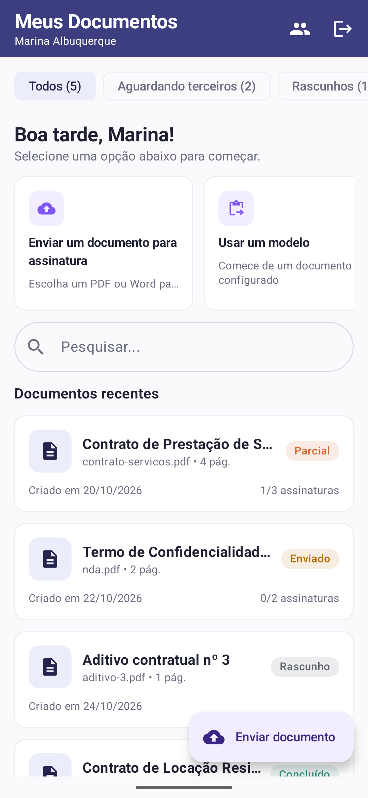<br/><sub>Admin: documentos</sub></td>
    <td align="center">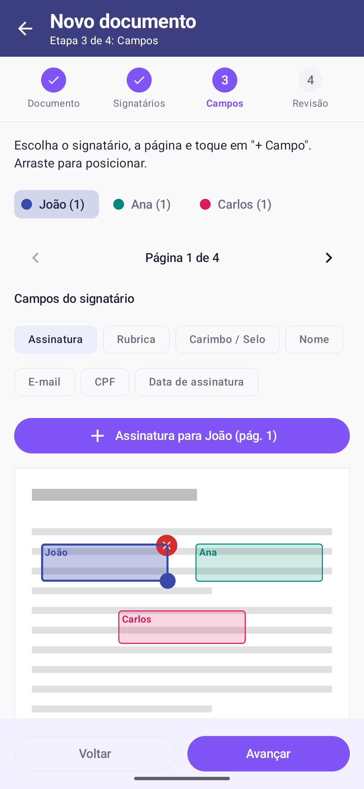<br/><sub>Posicionar campos</sub></td>
    <td align="center">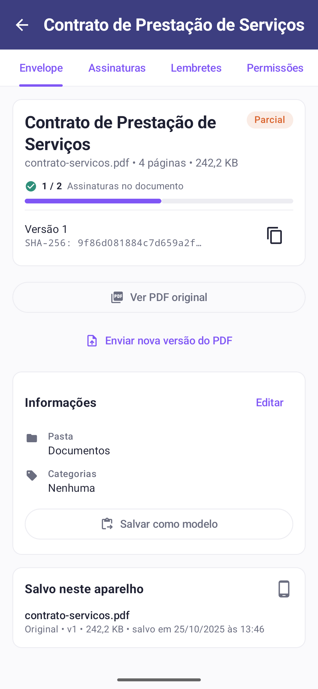<br/><sub>Acompanhamento</sub></td>
  </tr>
  <tr>
    <td align="center">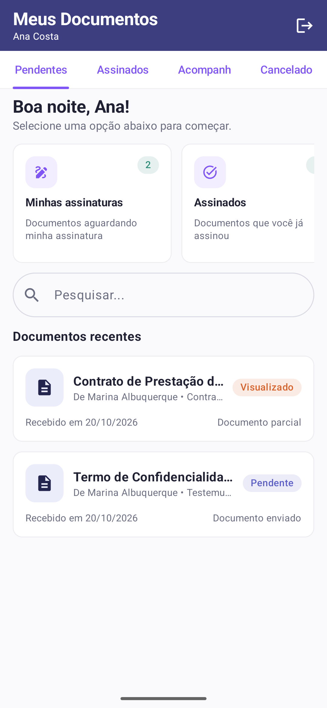<br/><sub>Signatário: pendentes</sub></td>
    <td align="center">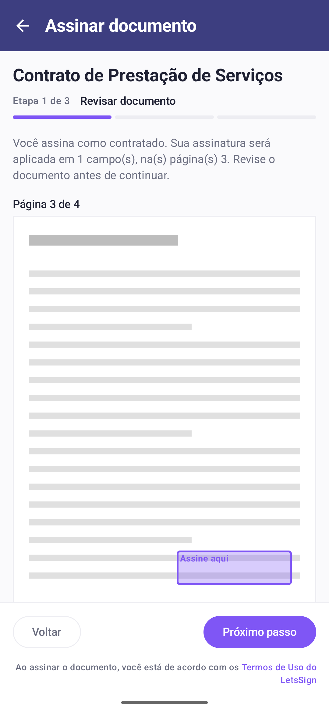<br/><sub>Assinar</sub></td>
    <td align="center">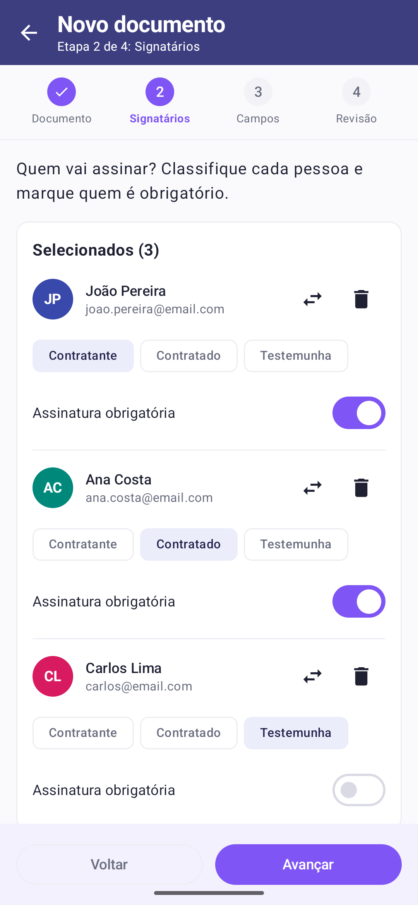<br/><sub>Escolher signatários</sub></td>
    <td align="center">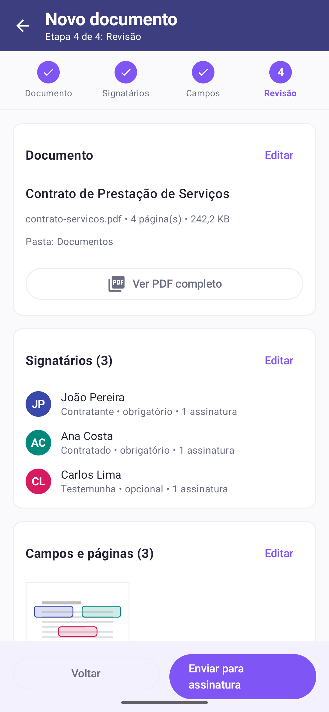<br/><sub>Revisar e enviar</sub></td>
  </tr>
  <tr>
    <td align="center">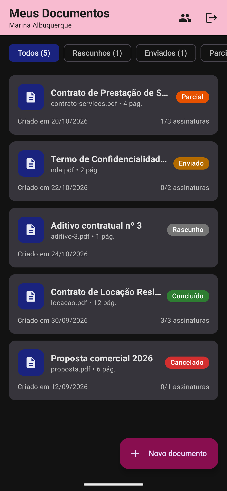<br/><sub>Modo escuro</sub></td>
    <td align="center">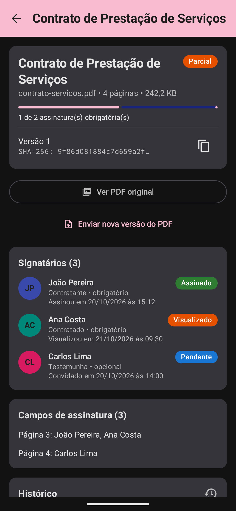<br/><sub>Modo escuro</sub></td>
    <td align="center">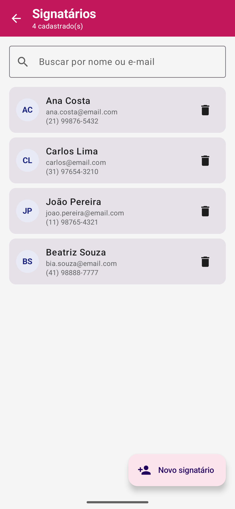<br/><sub>Cadastro de signatários</sub></td>
    <td align="center">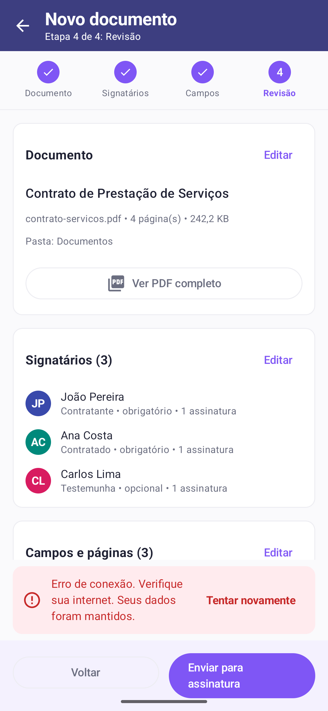<br/><sub>Falha: tentar sem duplicar</sub></td>
  </tr>
</table>

### No emulador, ligado à API (teste de 25/10; a API entra na fase 2)

<table>
  <tr>
    <td align="center">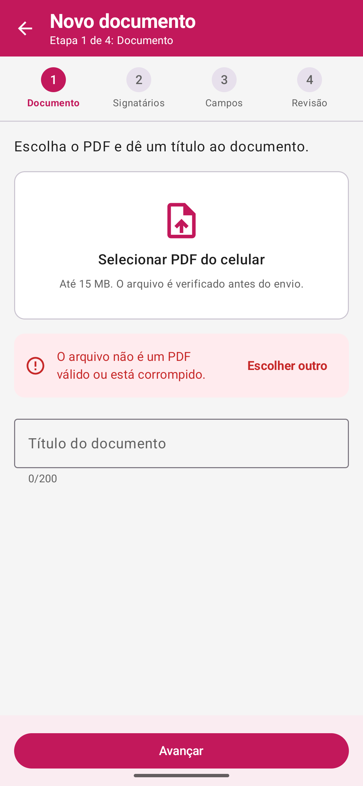<br/><sub>PDF corrompido recusado</sub></td>
    <td align="center">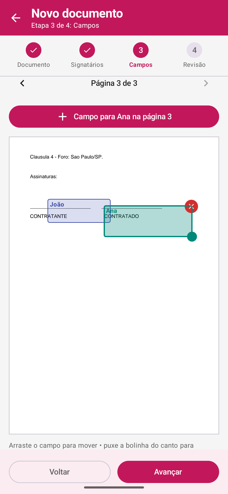<br/><sub>Campos no PDF real</sub></td>
    <td align="center">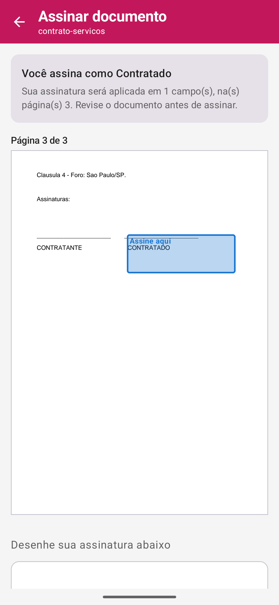<br/><sub>Signatário vê onde assinar</sub></td>
    <td align="center">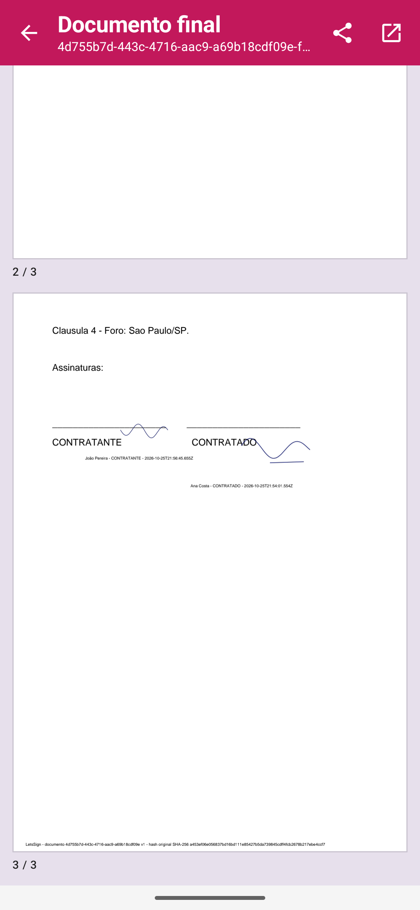<br/><sub>PDF final assinado</sub></td>
  </tr>
  <tr>
    <td align="center">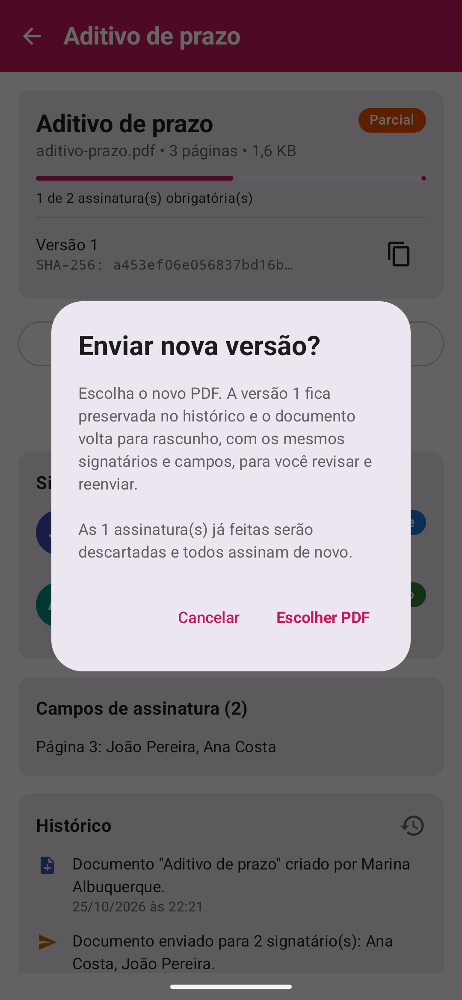<br/><sub>Nova versão: confirmação</sub></td>
    <td align="center">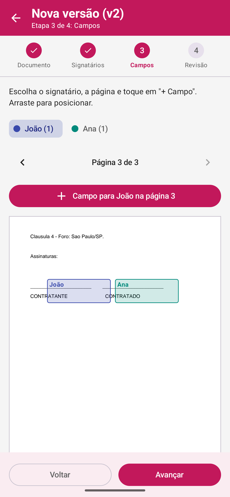<br/><sub>v2 com campos mantidos</sub></td>
    <td align="center">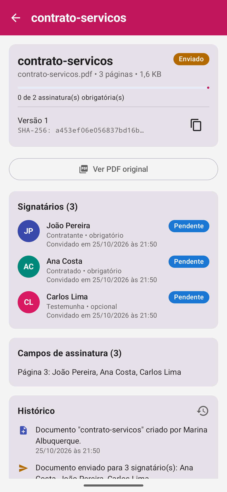<br/><sub>Acompanhamento</sub></td>
    <td align="center">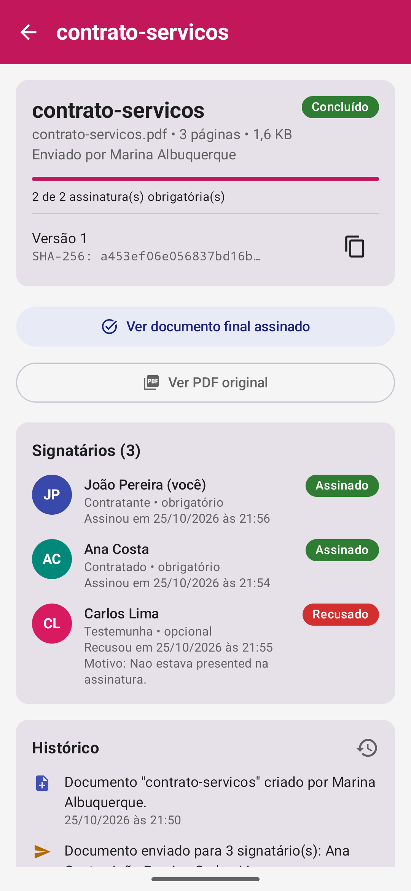<br/><sub>Concluído</sub></td>
  </tr>
</table>

> As telas da primeira parte saem dos `@Preview` do código, com dados fictícios. Para regerar: `bash docs/screenshots/capturar.sh`.

## ✨ Funcionalidades

**Admin**
- Envia um PDF do celular. O app recusa arquivo inválido, corrompido, protegido por senha ou acima de 15 MB.
- Escolhe e classifica signatários (contratante, contratado, testemunha), define quem é obrigatório, remove ou substitui.
- Vê as páginas e **posiciona os campos de assinatura arrastando**. Pode redimensionar, excluir e pôr vários campos por pessoa.
- Revisa tudo, escreve a mensagem do convite e envia. Se a conexão cair, **tenta de novo sem duplicar**.
- Acompanha a situação geral e a de cada signatário, com data e hora, o histórico completo e o PDF final assinado.
- Cadastra, edita, busca e remove signatários.
- Precisa mudar algo depois de enviar? **Envia uma nova versão do PDF.** A anterior fica preservada no histórico, as assinaturas recomeçam e signatários e campos são mantidos para revisar.

**Signatário**
- Vê os documentos pendentes, os assinados e os cancelados.
- Vê exatamente onde vai assinar, assina com o dedo ou recusa informando o motivo.
- O status é atualizado e o PDF final fica salvo no aparelho.

**Para os dois**
- **Banco local (Room)** e PDFs no aparelho: a lista abre na hora e funciona sem internet (leitura).
- Dados isolados por usuário, apagados no logout ou quando a sessão expira.
- Tema claro e escuro.

O que ainda pode evoluir está em **[MELHORIAS.md](MELHORIAS.md)**, com o placar de aderência ao desafio: **41 de 41 itens atendidos**.

## 🚀 Como rodar

O app funciona **sozinho, sem servidor**: contas, signatários, documentos, assinaturas e PDFs ficam no aparelho (Room + arquivos). É só instalar e usar.

### Passo a passo

1. No Android Studio (AGP 9.4, Gradle 9.8, **Android SDK 37**): **File → Open** → pasta **`lets-sign-android`** → aguarde o *Gradle sync*.
2. Escolha um emulador ou celular e clique em **▶ Run**.
3. **Cadastre-se**: a conta criada é de **Admin**.
4. Em **Signatários**, cadastre quem vai assinar (nome, e-mail, telefone e senha).
5. Toque em **Novo documento**, escolha o PDF, os signatários e posicione os campos. Revise e envie.
6. **Saia** e entre com o e-mail e a senha de um signatário: o documento aparece em **Pendentes**. Assine.
7. Quando todos os obrigatórios assinarem, o **PDF final assinado** fica salvo no aparelho e aparece no detalhe do documento.

> Sem servidor, o "convite" não chega por e-mail: o signatário vê o documento ao entrar no app no mesmo aparelho.

### Dados de demonstração

Na tela de login, toque em **Carregar dados de demonstração**. Em cerca de 20 segundos o app cria um Admin, 6 contatos e 17 documentos em todos os estágios (rascunho, enviado, visualizado, parcialmente assinado, concluído com PDF final, recusado e substituído por nova versão), com datas espalhadas pelos últimos 40 dias. O painel ESG fica no nível Árvore (1.248 folhas). Tocar de novo só entra, sem duplicar.

| Perfil | E-mail | Senha |
|---|---|---|
| Admin | `demo@easysign.com` | `demo123` |
| Signatários | `joao@demo.com`, `mariana@demo.com`, `rafael@demo.com`, `beatriz@demo.com`, `lucas@demo.com`, `fernanda@demo.com` | `demo123` |

### Modo API (fase 2, 2027)

Os repositórios seguem interfaces (`domain/repository`), então o mesmo app já sabe falar com uma API REST na porta 3000, usando o Room como cache. A API não faz parte desta entrega; quando ela existir:

```bash
./gradlew assembleDebug -Pmodo=api                                        # emulador (10.0.2.2:3000)
./gradlew assembleDebug -Pmodo=api -PapiUrl=http://192.168.0.10:3000/     # celular no mesmo Wi-Fi
```

### Linha de comando

```bash
./gradlew assembleDebug               # APK em app/build/outputs/apk/debug/
./gradlew installDebug                # instala no aparelho conectado
./gradlew testDebugUnitTest           # 42 testes unitários
./gradlew connectedDebugAndroidTest   # 9 testes no emulador: fluxo completo sem servidor, dados de demonstração e migração do banco
```

## 🏗️ Arquitetura

```
Telas (Compose) → ViewModels (StateFlow) → Interfaces de repositório ─┬─ Local*Repository → Room + arquivos   (padrão)
                                                                        └─ *RepositoryImpl  → API REST + Room (cache)   (-Pmodo=api)
```

- **Banco local como fonte da verdade** (`data/local/LocalRepositories.kt`): o próprio app aplica as regras (acesso por usuário, envio sem duplicar, conclusão só com todos os obrigatórios, nova versão preservando a anterior).
- **Repositórios por interface:** a troca entre local e REST é feita só na injeção de dependência (`di/RepositoryModule.kt`), sem tocar nas telas.
- **Regras de negócio** em funções puras e testadas (`domain/rules/DocumentRules.kt`).
- Cada tela tem `XxxScreen` (com ViewModel) e `XxxContent` (sem estado), o que permite **ver todas as telas no Preview do Android Studio** sem rodar o app nem o backend.

Rotas, tabelas, fluxos, regras e endpoints: **[docs/DOCUMENTACAO.md](docs/DOCUMENTACAO.md)**.

## 🧰 Tecnologias

| Área | Biblioteca |
|---|---|
| Interface | Jetpack Compose, Material 3, Navigation Compose |
| PDF | `PdfRenderer` nativo para exibir; **PDFBox-Android** para gerar o PDF final com as assinaturas |
| Banco local | Room 2.8 (esquema versionado em `app/schemas`) |
| Injeção de dependência | Hilt (KSP) |
| Rede | Retrofit 3, OkHttp, kotlinx-serialization |
| Testes / CI | JUnit, kotlinx-coroutines-test, GitHub Actions |

## 🔐 Segurança

- Senhas guardadas só como hash **PBKDF2 com sal** (nunca em texto).
- Cada usuário só vê os próprios documentos e os que foram **enviados** para ele; rascunhos não aparecem para signatários.
- Modo API: JWT em todas as requisições, e um **401 encerra a sessão** e apaga os dados locais. O token fica fora dos backups do Android.
- HTTP sem TLS é liberado só no build debug; o release exige HTTPS.
- Os PDFs ficam no armazenamento privado do app e são compartilhados via `FileProvider`.
- Cada assinatura vai com metadados do gesto (traços, pontos, duração, aparelho). O PDF original e o final têm hash SHA-256 registrado no histórico.

## 📄 Licença

Proprietário: LetsSign. Todos os direitos reservados.
